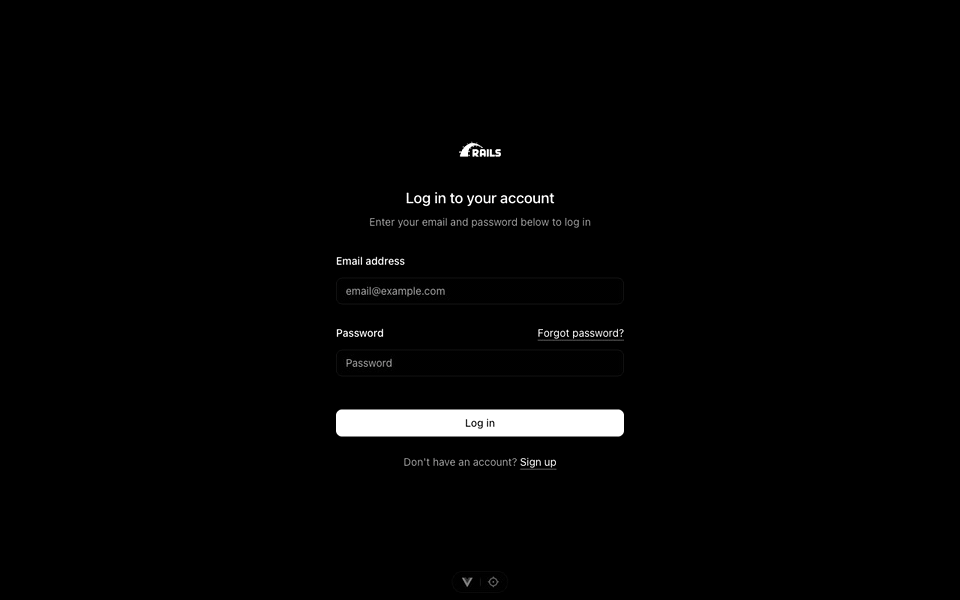

# rails-vue-starter

A starter for Rails apps with an Inertia + Vue frontend, written to be built mostly by coding agents. Every rule the agent has to follow is enforced by a check, and the checks are fast enough that nobody has a reason to skip them.

[](https://github.com/crow-rojas/rails-vue-starter/actions/workflows/ci.yml)
[](LICENSE)



> ¿Hablas español? La app viene en inglés y español: cada usuario elige su idioma, y quien no tiene cuenta ve el de su navegador.

## What you get

- Rails 8.1 on Ruby 4.0, Inertia 3 with Vue 3.5 and TypeScript, Tailwind 4 with shadcn-vue, PostgreSQL 18, and Solid Queue, Cache and Cable. It starts from the official [Inertia Rails generator](https://github.com/inertia-rails/generator) and keeps its choices.
- Sign up, sign in, email verification, password reset, sessions and account deletion, with rate limits on everything that checks a secret or sends an email.
- English and Spanish from one set of Rails locale files, used by both the server and the Vue pages.
- Typed props: page serializers become TypeScript types, so a page cannot read a prop the server does not send.
- A reference resource, `projects`, that shows where each piece goes, ready to copy.
- A harness for coding agents: hooks that lint each edit, a check after every agent turn, guards against deleted tests and rewritten migrations, and CI that runs the same script you run locally.
- A Kamal deploy to one server, with Postgres, daily encrypted backups and a restore drill. It has been deployed to a real server, next to another app.
- Error and job dashboards for admins at `/admin/errors` and `/admin/jobs`.

## Start an app from it

You need Ruby and Node at the versions in `.ruby-version` and `.node-version` (any version manager that reads those files works) and Docker for the database. [gitleaks](https://github.com/gitleaks/gitleaks) is optional; without it the hooks use its Docker image, which does not work inside git worktrees.

1. Click **Use this template** on GitHub, or clone the repository.
2. Rename it to your app. `bin/rename` shows what would change; add `--apply` to write it.

   ```sh
   bin/rename "Invoice Hub" --apply
   ```

3. Set it up and run it:

   ```sh
   bin/setup
   ```

`bin/setup` installs gems, packages and git hooks, writes `.env` with free ports for Postgres and the app (so several checkouts can run at once), starts Postgres in Docker, prepares and seeds the databases and starts the app. Sign in as `demo@example.com` with the password `demo-password-123`. That account exists only in development, and it can open the admin dashboards.

After renaming, replace this README with one for your app, update the copyright line in `LICENSE`, and change the links in the sidebar footer (`app/javascript/components/AppSidebar.vue`), which point at this repository.

## Working with a coding agent

`AGENTS.md` (also available as `CLAUDE.md`) is the short guide agents read first: the commands, where things live, and the rules. Each rule names the tool that enforces it, so the agent finds out it broke one from a failing check rather than from a reviewer.

| When | What runs | Time |
|---|---|---|
| After the agent edits a file | RuboCop, or ESLint and Prettier, on that file | about 1 s |
| `git commit` | Linters on the staged files, a secret scan, Conventional Commits | about 1 s |
| When the agent ends its turn | `bin/check`: lint, types, generated types, guards, unit and Rails tests | about 13 s |
| `git push`, and CI on every pull request | `bin/ci`: everything above plus audits, Brakeman, secret scan of the history, system tests | about 40 s locally |

The hooks give fast feedback, but anyone determined can get past them. The real gate is GitHub: `main` only moves through `bin/merge`, which fast-forwards it to a pull request whose checks passed and whose commits are signed. The design and its limits are in [ADR-002](docs/adr/002-agent-harness.md).

The hooks are wired for Claude Code (`.claude/settings.json`). Other agents read the same `AGENTS.md` and hit the same git hooks and CI.

## Everyday commands

| Command | Does |
|---|---|
| `bin/dev` | Runs Rails and Vite |
| `bin/check` | The fast check |
| `bin/ci` | Every check CI runs |
| `bin/rails test`, `bin/rails test:system` | Rails and browser tests |
| `pnpm test`, `pnpm check`, `pnpm lint` | Vitest, the Vue type check, ESLint |
| `bin/rename "New Name"` | Renames the template to your app |
| `bin/merge <pr>` | Merges a green pull request into `main` |

To add a resource, copy the shape of `projects`: its model, controller, serializers, pages and tests. [ADR-005](docs/adr/005-application-shape.md) explains each piece and when an extra layer, like an operation or a form object, is worth adding.

## Deploy

You need one server with Docker and SSH as root, a domain pointing at it, an SMTP account and an S3-compatible bucket. The details are in [ADR-006](docs/adr/006-deploy.md).

```sh
export KAMAL_HOST=203.0.113.10 APP_HOST=app.example.com
export MAIL_FROM=hello@example.com SMTP_ADDRESS=smtp.example.com SMTP_USERNAME=apikey
export ADMIN_EMAILS=you@example.com   # sees /admin/errors and /admin/jobs, gets new errors by email
export BACKUP_S3_ENDPOINT=https://<account>.r2.cloudflarestorage.com BACKUP_S3_REGION=auto BACKUP_S3_BUCKET=my-app-backups
export SECRET_KEY_BASE=$(bin/rails secret) POSTGRES_PASSWORD=... SMTP_PASSWORD=...
export BACKUP_S3_ACCESS_KEY_ID=... BACKUP_S3_SECRET_ACCESS_KEY=... BACKUP_PASSPHRASE=...

bin/kamal setup     # the first time: server, accessories and app
bin/kamal deploy    # every time after that
```

Nothing about your server goes into the repository; `config/deploy.yml` reads it from these variables. Keep the secrets in a password manager rather than in your shell history (`.kamal/secrets` explains how). `KAMAL_HOST` can be an alias from `~/.ssh/config`. If the domain is on Cloudflare, keep the record as DNS only until the first certificate is issued.

After the first deploy, check that an email arrives and test the backups: `bin/kamal backup` takes one and `bin/kamal backup-drill` restores it into a scratch database. `bin/kamal restore` restores over the live database, so keep it for a real recovery.

## Decisions

The reasons behind the stack and the conventions live in [`docs/adr`](docs/adr), with the events that would reopen each decision:

1. [Stack](docs/adr/001-stack.md)
2. [Agent harness](docs/adr/002-agent-harness.md)
3. [Security baseline](docs/adr/003-security-baseline.md)
4. [Internationalization](docs/adr/004-i18n.md)
5. [Application shape](docs/adr/005-application-shape.md)
6. [Deploy](docs/adr/006-deploy.md)

Every pinned version and its source is in [`docs/research/versions.md`](docs/research/versions.md).

## Keeping up with the template

An app made with **Use this template** starts with its own history, so improvements here do not reach it on their own. [`CHANGELOG.md`](CHANGELOG.md) and the release notes say what changed and what to port by hand. To pull everything at once, add this repository as a remote and merge it; expect conflicts the first time:

```sh
git remote add template https://github.com/crow-rojas/rails-vue-starter.git
git fetch template
git merge template/main --allow-unrelated-histories
```

## Contributing and security

Bug reports and pull requests are welcome; see [CONTRIBUTING.md](CONTRIBUTING.md). Report vulnerabilities privately, as described in [SECURITY.md](SECURITY.md).

## License

[MIT](LICENSE)
